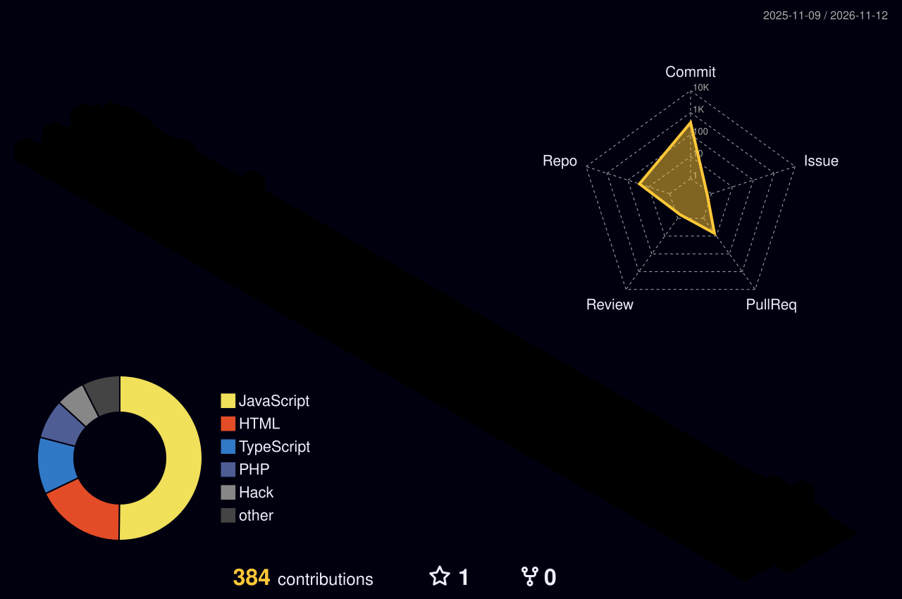

# 👨‍💻 Abdellah Ait Bhou
### Full-Stack Developer | Laravel & MERN Stack | Cybersecurity & Networks Graduate
**YouCode (UM6P Campus)** 🇲🇦

  

---

### 🚀 About Me

I am a passionate **Full-Stack Developer** currently enrolled in the **Full Stack-MERN** program at **YouCode (UM6P Campus)**, holding a **Bachelor's degree (Licence) in Computer Security and Networks** and a **DUT in Computer Engineering** from EST Guelmim.

- 🎓 **Education:** Full-Stack MERN @ YouCode UM6P | Licence in Computer Security & Networks.
- 💡 **Core Expertise:** Designing robust REST APIs, modular backend architecture, secure role-based systems, and clean interactive frontends.
- 💼 **Professional Experience:** Built an interactive electoral GIS/e-government web platform for **Province de Rhamna (Benguerir)** and an e-commerce platform for **Omnium de la Pêche Marocaine**.
- 🔐 **Security-Minded:** Practical knowledge of authentication (Sanctum, JWT, bcrypt), role/permission controls, and SQL injection prevention.
- 💬 Ask me about **Laravel, Node.js, Vue.js, Docker, and Database Optimization**.

---

### 🛠️ Skills & Technologies

<table>
  <tr>
    <td align="center" width="130"><strong>Backend & APIs</strong></td>
    <td>
      
       
      <code>PHP (Laravel 11/12)</code> <code>Node.js</code> <code>Express.js</code> <code>Python (Django)</code> <code>RESTful APIs</code> <code>JWT / Sanctum</code> <code>Swagger</code> <code>PHPUnit</code>
    </td>
  </tr>
  <tr>
    <td align="center" width="130"><strong>Frontend</strong></td>
    <td>
      
       
      <code>JavaScript (ES6+)</code> <code>TypeScript</code> <code>Vue.js 3</code> <code>React.js</code> <code>Alpine.js</code> <code>Blade</code> <code>Tailwind CSS</code> <code>Leaflet.js</code>
    </td>
  </tr>
  <tr>
    <td align="center" width="130"><strong>Databases</strong></td>
    <td>
      
       
      <code>PostgreSQL</code> <code>MongoDB (Mongoose)</code> <code>MySQL</code> <code>SQLite</code> <code>Eloquent ORM</code>
    </td>
  </tr>
  <tr>
    <td align="center" width="130"><strong>DevOps & Tools</strong></td>
    <td>
      
       
      <code>Docker & Docker Compose</code> <code>GitHub Actions</code> <code>Git</code> <code>Linux</code> <code>Postman</code> <code>Figma</code>
    </td>
  </tr>
</table>

---

### 💼 Featured Projects

#### 🗳️ [Système de Gestion Électorale — Province de Rhamna](https://github.com/aitbhou2003)
> **Professional Internship Project** | *Laravel 11, Vue.js 3, PostgreSQL, Leaflet.js, GeoJSON, Laravel Sanctum*
- Modernized legacy Excel/QGIS workflows into a secured dynamic web application.
- Interactive GIS map for **409 polling stations** with real-time GeoJSON rendering via Leaflet.js.
- Secure REST API with role & permission management (Sanctum) and automated Excel import/export pipelines.

#### 🏠 [EasyColoc — Shared Accommodation Platform](https://github.com/aitbhou2003)
> **Web Application** | *Laravel 12, Eloquent ORM, MySQL/SQLite, Blade, Tailwind CSS, Alpine.js, PHPUnit*
- Flat-sharing and expense management platform with token-based invite links.
- Category-based expense tracking, peer-to-peer repayment calculations, reputation scoring, and admin dashboard.
- Full unit & feature test coverage using PHPUnit.

#### 🚛 [Fleet Management REST API](https://github.com/aitbhou2003)
> **Backend System** | *Node.js, Express.js, MongoDB, Mongoose, JWT, bcrypt, Joi, Docker, Postman*
- Road transport fleet API managing trucks, trailers, drivers, mileage, and maintenance schedules.
- Role-based authorization (RBAC), request validation (Joi), and containerized deployment with Docker Compose.

#### 🏋️ [SportConnect Pro — Association Management](https://github.com/aitbhou2003)
> **Sports & Infrastructure Platform** | *Node.js, PostgreSQL, EJS, find-my-way, Docker*
- Sports club management platform handling facilities, member registrations, and family subscriptions.
- Implemented transactional PostgreSQL logic for race conditions and registration integrity.

---

### 📈 GitHub Contribution Activity

  <!-- Option A: 3D Contribution City View -->
  

---

### 📊 GitHub Analytics

  
  

  

---

### 📫 Let's Connect

